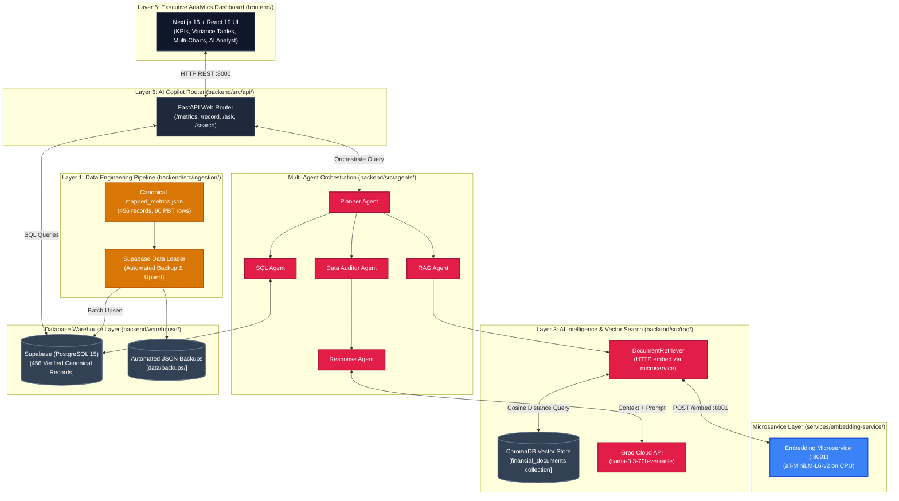
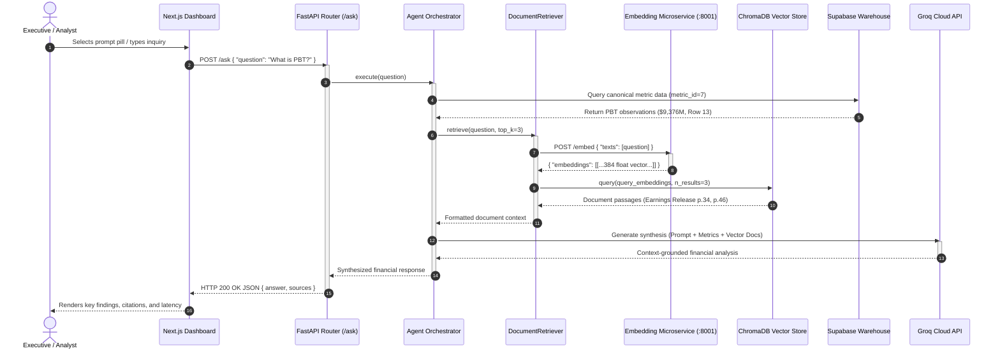

<!-- -------------------------------------------------------------------
Copyright (c) 2026 Ved Vivek Talmaley. All Rights Reserved.
This project and its source code are strictly proprietary.
Unauthorized copying, distribution, or use is strictly prohibited.
------------------------------------------------------------------- -->

# System Architecture Specification — Version 10.0.0

This document details the architectural layout, system layers, and component interactions of **QuantumLens** (also known as *HSBC Atlas* or *Project Basilisk*), an institutional-grade banking intelligence platform for HSBC Q1 2026 reporting.

For a high-level overview, deployment metrics, or setup instructions, see the primary [README.md](../../README.md). For frontend dashboard details, see [frontend/README.md](../../frontend/README.md). For backend services, see [backend/README.md](../../backend/README.md).

---

## 6-Layer Architecture Overview

QuantumLens is built on six decoupled engineering layers. This decoupling ensures that dense vector embeddings, LLM reasoning, and database warehouse operations run reliably with zero circular dependencies.

---

## Technical Layers Matrix

| Layer | Responsibility | Input Shape | Output Shape | Data Store Target |
| :--- | :--- | :--- | :--- | :--- |
| **Layer 1: Pipeline** | Validating canonical financial records and executing natural key upserts. | Raw Excel files (`.xlsx`) / canonical JSON | Cleaned 456 JSON metric coordinates | Supabase / Automated Backups |
| **Layer 2: Graph** | Modeling counterparty risk, wealth flows, and systemic contagion paths (Roadmap). | Structured KPI metrics | Entity node networks and exposures | Neo4j Graph DB |
| **Layer 3: NLP & Vectors** | Generating 384-dimensional dense vectors via microservice and querying ChromaDB. | User query strings | Top-k contextual financial passages | ChromaDB Vector Store |
| **Layer 4: Forecasting** | Modeling macro rate scenarios on NII and deposit migration (Roadmap). | Relational metrics history | Predictive timeline indicators | Warehouse databases |
| **Layer 5: UI Portal** | Executive war-room dashboard with statement tables, variance analysis, and charts. | REST responses, user interactions | Interactive financial tables & charts | Next.js 16 (Vercel) |
| **Layer 6: AI Copilot** | Multi-agent orchestrated reasoning combining SQL metrics with semantic search documents. | Natural language questions | Factual, source-attributed financial replies | FastAPI (Render / Docker) |

---

## Modular System Breakdown

| Script / Module | Architecture Layer | Core Function | Primary Python Packages | File Path |
| :--- | :--- | :--- | :--- | :--- |
| **data_loader.py** | Layer 1: Data Pipeline | Validates canonical metrics, creates backup snapshot, and upserts to Supabase. | `supabase`, `argparse`, `json` | [data_loader.py](../../backend/warehouse/data_loader.py) |
| **supabase_client.py** | Layer 1: Data Pipeline | Manages lazy singleton client connection to Supabase PostgreSQL warehouse. | `supabase`, `dotenv` | [supabase_client.py](../../backend/warehouse/supabase_client.py) |
| **query_service.py** | Layer 6: AI Copilot | Metric alias resolution (PBT, CET1, NII) and sorted sheet querying. | `supabase` | [query_service.py](../../backend/warehouse/query_service.py) |
| **document_retriever.py**| Layer 3: AI Intelligence | Routes query embedding requests to microservice and queries local ChromaDB. | `chromadb`, `urllib.request` | [document_retriever.py](../../backend/src/rag/document_retriever.py) |
| **app.py (Embedding)** | Microservice Layer | Standalone FastAPI microservice generating sentence embeddings via PyTorch CPU. | `fastapi`, `sentence-transformers` | [app.py](../../services/embedding-service/app.py) |
| **orchestrator.py** | Layer 6: AI Copilot | Multi-agent execution loop with memory resolution, planning, and auditing. | Internal agent framework | [orchestrator.py](../../backend/src/agents/orchestrator.py) |
| **planner.py** | Layer 6: AI Copilot | Analyzes user question and produces multi-step execution plans. | Internal agent framework | [planner.py](../../backend/src/agents/planner.py) |
| **llm_service.py** | Layer 6: AI Copilot | Context-grounded LLM answer generation with lazy Groq client initialization. | `groq` | [llm_service.py](../../backend/src/rag/llm_service.py) |
| **main.py** | Layer 6: REST API | Root FastAPI application mounting routers for metrics, records, RAG, and health. | `fastapi`, `uvicorn` | [main.py](../../backend/src/api/main.py) |

---

## Multi-Agent RAG Query Sequence Diagram

---

## Canonical Data Verification Matrix

| Verification Target | Expected Standard | Observed Production Status |
| :--- | :--- | :--- |
| **Total Metric Records** | 456 rows | **456 rows verified in Supabase** |
| **Profit Before Tax (PBT)** | 90 rows across business segments | **90 rows verified active** |
| **CET1 Capital & Ratio** | Full capital adequacy notes | **Verified in balance sheet & schedules** |
| **Net Interest Income (NII)** | 3 group observations | **Verified in group income statement** |
| **Database Conflict Key** | `metric_id, sheet_name, row_number` | **Enforced via Supabase unique index** |
| **Automated Backups** | Timestamped JSON before load | **Persisted in `backend/data/backups/`** |

---

## Proprietary License Notice

> **Copyright © 2026 Ved Vivek Talmaley. All Rights Reserved.**  
> *This project and its original source code are strictly proprietary. Unauthorized copying, modification, distribution, or reproduction of this repository, via any medium, is strictly prohibited.*
