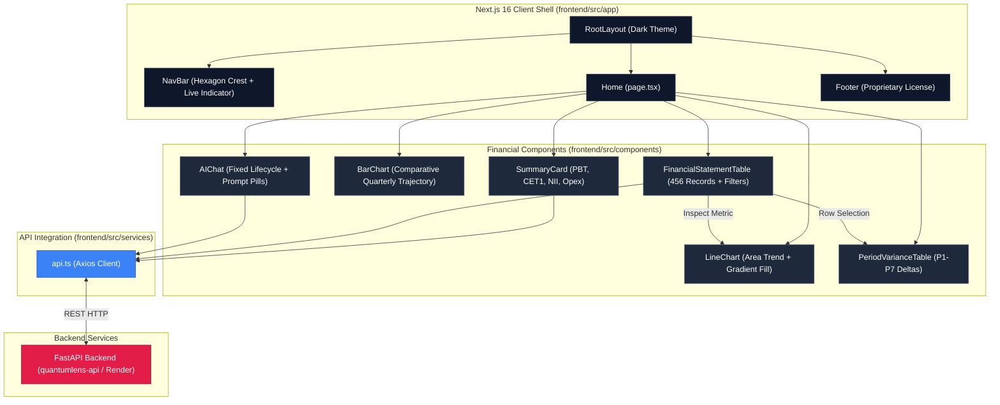

<!-- -------------------------------------------------------------------
Copyright (c) 2026 Ved Vivek Talmaley. All Rights Reserved.
This project and its source code are strictly proprietary.
Unauthorized copying, distribution, or use is strictly prohibited.
------------------------------------------------------------------- -->

# Next.js Analytics Portal (frontend/) — Version 10.0.0

This is the executive client dashboard for the **QuantumLens** financial intelligence platform. It provides an institutional interface for strategy, risk observation, financial statement audit, and natural language reasoning for HSBC Q1 2026.

For general backend endpoints, models, or database queries, see [backend/README.md](../backend/README.md). For system-wide design and layer specifications, see the root [README.md](../README.md).

---

## Technical Stack & Visual Framework

| Layer | Selected Package | Version | Purpose |
| :--- | :--- | :--- | :--- |
| **Framework** | Next.js (App Router) | `16.2.10` | Core server components, Turbopack builds, and optimized layouts. |
| **UI Library** | React | `19.2.4` | Modern component lifecycle, hooks state, and dynamic rendering. |
| **Styling Engine**| TailwindCSS + CSS Variables | `^4.3.3` | Institutional slate dark theme, glassmorphism, and custom scrollbars. |
| **Data Graphs** | Chart.js + react-chartjs-2 | `^4.5.1` / `^5.3.1` | Time-series area trends and comparative quarterly bar charts. |
| **HTTP Client** | Axios | `^1.18.1` | REST calls to FastAPI backend with timeout guards. |
| **Deployment** | Vercel | Production | Automatic CI/CD build deployment. |

---

## Frontend Architecture Diagram

---

## Component Inventory & Responsibilities

| Component | File Location | Responsibility | Interactivity |
| :--- | :--- | :--- | :--- |
| **NavBar** | `src/components/layout/NavBar.tsx` | Brand header, navigation links, and live backend data indicator. | Sticky backdrop blur, smooth anchor scroll. |
| **Hero** | `src/components/layout/Hero.tsx` | Executive banner summarizing Q1 2026 data pack sources. | Glassmorphism card, ambient gradient accents. |
| **SummaryCard** | `src/components/dashboard/SummaryCard.tsx` | Displays high-level KPIs (PBT, CET1, NII, Opex) with variance badges. | Hover glow and status pill highlights. |
| **LineChart** | `src/components/charts/LineChart.tsx` | Renders multi-period trend curves with area fills and hover tooltips. | Metric selector buttons, responsive canvas. |
| **BarChart** | `src/components/charts/BarChart.tsx` | Visualizes quarterly performance across revenue, expenses, and profit. | Multi-dataset bar grouping with legend toggles. |
| **FinancialStatementTable**| `src/components/tables/FinancialStatementTable.tsx` | Displays canonical statement records with pagination and search. | Sheet filter pills, real-time search, one-click row inspect. |
| **PeriodVarianceTable** | `src/components/tables/PeriodVarianceTable.tsx` | Calculates period-over-period variance ($M and %) across all 7 periods. | Delta calculations, growth/decline status tags. |
| **AIChat** | `src/components/ai/AIChat.tsx` | Executive financial intelligence copilot (bug-free, no infinite loop). | Prompt pills, latency timer, resilient fallback synthesis. |
| **Footer** | `src/components/layout/Footer.tsx` | Displays official proprietary license notice and runtime stack attribution. | Responsive legal compliance banner. |

---

## Getting Started

### Prerequisites
- Node.js 18.x or later installed
- Running instance of QuantumLens FastAPI backend (`http://localhost:8000` or production Render API)

### Local Development Commands

| Action | Command | Purpose |
| :--- | :--- | :--- |
| **Install Dependencies** | `npm install` | Restores Next.js, React, Tailwind, Chart.js, and Axios. |
| **Start Development Server** | `npm run dev` | Launches Turbopack dev server on [http://localhost:3000](http://localhost:3000). |
| **Compile Production Build** | `npm run build` | Compiles optimized static output with full TypeScript validation. |
| **Start Production Server** | `npm run start` | Serves the optimized production build locally. |
| **Run Linter** | `npm run lint` | Runs ESLint check across all TSX components. |

---

## Environment Variables

| Variable Name | Required | Target Runtime | Description | Default |
| :--- | :--- | :--- | :--- | :--- |
| `NEXT_PUBLIC_API_URL` | Yes | Client / SSR | Base URL for FastAPI backend endpoints. | `https://quantumlens-api.onrender.com` |

---

## Proprietary License Notice

> **Copyright © 2026 Ved Vivek Talmaley. All Rights Reserved.**  
> *This project and its original source code are strictly proprietary. Unauthorized copying, modification, distribution, or reproduction of this repository, via any medium, is strictly prohibited.*
